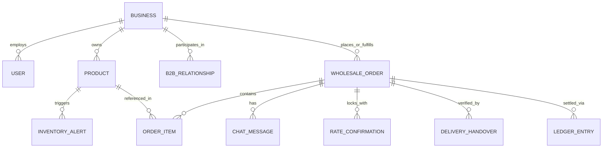

# SharVin: Database Design & Schema Specification

**Status:** CONFIRMED (Derived from db for king.txt & Additional Recommendations)
**Last Updated:** 2026-10-31
**Target Database:** PostgreSQL

---

## 1. Design Principles `[CONFIRMED]`

1. **Relational Integrity & ACID Transactions:** B2B financial ledgers, inventory counts, rate locks, and OTP validations execute in atomic database transactions.
2. **Immutable Audit Trails:** Financial ledger entries, payment collections, and price confirmation history are append-only.
3. **Multi-Tenancy & User Typing:** Users are partitioned by `user_type` (`retailer`, `wholesaler`, `driver`) and linked via explicit `retailer_wholesaler_connections`.
4. **Obligation Integrity:** Retailer-wholesaler connections cannot be severed or blocked if active pending orders or unpaid ledger balances exist.
5. **Subscription Tiering:** Built-in modular feature packages (`BASIC`, `SMART`, `B2B_LITE`, `B2B_PRO`) with usage logging.

---

## 2. Entity-Relationship Diagram (ERD) `[PROPOSED]`

---

## 3. Core Schema Definitions `[PROPOSED]`

### 3.1. `businesses` (Tenants)
Stores retail shops and wholesale distributors.
- `id` (UUID, PK)
- `type` (ENUM: `'RETAILER'`, `'WHOLESALER'`)
- `name` (VARCHAR, Store or Business Name)
- `phone` (VARCHAR, Unique)
- `address` (TEXT)
- `gstin_or_tax_id` (VARCHAR, Optional)
- `created_at` (TIMESTAMP)

### 3.2. `users`
Accounts belonging to businesses (owners, staff, delivery personnel).
- `id` (UUID, PK)
- `business_id` (UUID, FK -> `businesses.id`)
- `role` (ENUM: `'OWNER'`, `'STAFF'`, `'DELIVERY_AGENT'`)
- `name` (VARCHAR)
- `phone` (VARCHAR, Unique)
- `password_hash` (VARCHAR)
- `is_active` (BOOLEAN)
- `created_at` (TIMESTAMP)

---

## 4. OMS Lifecycle Extension `[CONFIRMED ADDITIVE MODEL; TRANSITION POLICY PROPOSED]`

The OMS lifecycle is stored separately from the legacy `orders.order_status` during compatibility rollout. `orders.lifecycle_status` uses `OrderLifecycleStatus` (`draft`, `submitted`, `accepted`, `picking`, `dispatched`, `delivered`, `rejected`, `cancelled`, `partially_fulfilled`). This preserves existing cart, negotiation, and delivery behavior while the OMS transition path is adopted.

`wholesaler_stock_reservations` records each stock decrement against one order item (`order_id`, unique `order_item_id`, `wholesaler_product_id`, positive `quantity`, `status`, and lifecycle timestamps). Acceptance reserves the final agreed quantity (adjusting any prior hold); cancellation/rejection releases active reservations with a locked stock increment; dispatch marks active reservations fulfilled in the same transaction as its lifecycle event.

`order_events` is the immutable-by-application audit journal for lifecycle changes:

- `order_event_id` (TEXT, PK)
- `order_id` (TEXT, FK -> `orders.order_id`)
- `from_status` (OrderLifecycleStatus, nullable only for a future creation event)
- `to_status` (OrderLifecycleStatus)
- `actor_user_id` (nullable TEXT, FK -> `users.user_id`; null for verified temporary driver-link actors)
- `actor_role` (UserType)
- `actor_source` (TEXT, e.g. `authenticated_user` or `driver_access_token`)
- `actor_reference` (TEXT, non-secret source reference such as delivery ID)
- `reason` (JSONB, structured code/message/details)
- `created_at` (TIMESTAMP, database default)

The additive migration backfills lifecycle status from legacy `order_status`, leaves legacy values unchanged, and creates no fabricated actor events for historical transitions. New lifecycle transitions must update `orders.lifecycle_status` and append one `order_events` row in the same transaction. Verified temporary driver links are audited by delivery ID; the access token itself is never stored in the event. The ORM model alone does not make rows physically immutable; production database permissions should restrict event updates/deletes.

### 3.3. `b2b_relationships`
Binds a retailer to their trusted wholesale suppliers.
- `id` (UUID, PK)
- `retailer_id` (UUID, FK -> `businesses.id`)
- `wholesaler_id` (UUID, FK -> `businesses.id`)
- `credit_limit` (DECIMAL, default 0.00)
- `current_credit_balance` (DECIMAL, default 0.00)
- `status` (ENUM: `'ACTIVE'`, `'PENDING'`, `'BLOCKED'`)
- `created_at` (TIMESTAMP)
- *Constraint:* Unique (`retailer_id`, `wholesaler_id`)

### 3.4. `products` (Inventory & Catalogs)
Supports both Retail POS items and Wholesale bulk items.
- `id` (UUID, PK)
- `business_id` (UUID, FK -> `businesses.id`)
- `name` (VARCHAR)
- `sku` / `barcode` (VARCHAR, Indexed)
- `category` (VARCHAR)
- `unit` (VARCHAR, e.g. `'pcs'`, `'box'`, `'kg'`, `'carton'`)
- `current_stock` (INTEGER)
- `min_reorder_threshold` (INTEGER, for low-stock restock triggers)
- `cost_price` (DECIMAL)
- `selling_price` (DECIMAL, standard catalog price)
- `linked_wholesaler_id` (UUID, Optional FK -> `businesses.id`, default supplier for 1-click restock)
- `created_at`, `updated_at` (TIMESTAMP)

### 3.5. `wholesale_orders` & `order_items`
- `wholesale_orders`:
  - `id` (UUID, PK)
  - `order_number` (VARCHAR, Unique formatted ID)
  - `retailer_id` (UUID, FK -> `businesses.id`)
  - `wholesaler_id` (UUID, FK -> `businesses.id`)
  - `status` (ENUM: `'DRAFT_CART'`, `'NEGOTIATING'`, `'RATE_LOCKED'`, `'DISPATCHED'`, `'DELIVERED'`, `'CANCELLED'`)
  - `total_amount` (DECIMAL)
  - `created_at`, `updated_at` (TIMESTAMP)
- `order_items`:
  - `id` (UUID, PK)
  - `order_id` (UUID, FK -> `wholesale_orders.id`)
  - `product_id` (UUID, FK -> `products.id`)
  - `quantity` (INTEGER)
  - `initial_unit_price` (DECIMAL)
  - `agreed_unit_price` (DECIMAL, updated upon rate lock)
  - `total_price` (DECIMAL)

### 3.6. `chat_messages` (Embedded Negotiation Chat)
- `id` (UUID, PK)
- `order_id` (UUID, FK -> `wholesale_orders.id`, Indexed)
- `sender_user_id` (UUID, FK -> `users.id`)
- `sender_business_id` (UUID, FK -> `businesses.id`)
- `message_type` (ENUM: `'TEXT'`, `'PRICE_PROPOSAL'`, `'RATE_CONFIRMATION_NOTICE'`)
- `proposed_payload` (JSONB, for structured counter-offers like itemized pricing)
- `content` (TEXT)
- `created_at` (TIMESTAMP)

### 3.7. `rate_confirmations` (Bilateral Mutual Lock)
- `id` (UUID, PK)
- `order_id` (UUID, FK -> `wholesale_orders.id`, Unique)
- `agreed_snapshot` (JSONB, snapshot of exact locked items, quantities, and rates)
- `retailer_confirmed_at` (TIMESTAMP, Nullable)
- `wholesaler_confirmed_at` (TIMESTAMP, Nullable)
- `is_locked` (BOOLEAN, default FALSE, set TRUE when both confirm)
- `locked_at` (TIMESTAMP, Nullable)

### 3.8. `delivery_handovers` (Two-Way Handover OTP)
- `id` (UUID, PK)
- `order_id` (UUID, FK -> `wholesale_orders.id`, Unique)
- `retailer_otp_hash` (VARCHAR, securely hashed 6-digit OTP provided to retailer)
- `attempts` (INTEGER, max attempts limit to prevent brute force)
- `verified_at` (TIMESTAMP, Nullable)
- `verified_by_user_id` (UUID, Delivery agent who verified)
- `status` (ENUM: `'PENDING'`, `'VERIFIED'`, `'FAILED'`)

### 3.9. `ledger_entries` (B2B Cash & Credit Ledger)
Immutable audit journal.
- `id` (UUID, PK)
- `retailer_id` (UUID, FK -> `businesses.id`)
- `wholesaler_id` (UUID, FK -> `businesses.id`)
- `order_id` (UUID, Optional FK -> `wholesale_orders.id`)
- `entry_type` (ENUM: `'ORDER_DEBIT'`, `'CASH_PAYMENT'`, `'ONLINE_PAYMENT'`, `'CREDIT_ADJUSTMENT'`)
- `amount` (DECIMAL)
- `running_balance` (DECIMAL, updated credit standing)
- `notes` (TEXT)
- `recorded_by_user_id` (UUID, FK -> `users.id`)
- `created_at` (TIMESTAMP)

### 3.10 Current Prisma ledger implementation notes `[CONFIRMED; migration deployed to dev DB 2026-11-04]`

The legacy sketch above is not the deployed schema contract. The current Prisma implementation uses `ledger_accounts` as the buyer/seller relationship balance projection, `ledger_transactions` as append-only source-event headers, and `ledger_entries` as balanced debit/credit journal lines. `ledger_credit_reservations` holds exposure for accepted orders until delivery, cancellation, or rejection. Source event keys are unique; corrections link to the original via `reversal_of_id` and add new lines. PostgreSQL migration triggers reject updates/deletes and enforce at least two balanced lines at commit. Unassigned payment amounts are allocated to oldest open invoices FIFO after order-linked invoices receive their payment allocation.

### 3.11 Invoice & voucher persistence (P0.1) `[CONFIRMED; IMPLEMENTED_AND_VERIFIED 2026-11-04]`

Developer-confirmed conventions for the P0.1 sub-module:

- The GST invoice table is the existing `Invoice` model (`invoices`, `20261104120000_add_invoices_and_vouchers`); it is **not** renamed to `GstInvoice`. It carries `invoice_number` (unique), `order_id` (unique FK → `orders`), seller/buyer GSTIN (`wholesaler_gstin`/`retailer_gstin`), `taxable_amount`, `cgst_amount`/`sgst_amount`/`igst_amount`, `signature_hash`, `qr_code_data`, and `issued_at`/`created_at`/`updated_at`. `invoice.service.ts` reads and writes it exclusively through Prisma (`create`/`findUnique`); the former in-memory invoice cache is removed, and DB errors surface instead of silently falling back.
- Khata lump-sum repayment idempotency is enforced on `payment_records.idempotency_key` (unique). `khata_settlement_vouchers` inherit replay safety through their `payment_record_id` link; no duplicate idempotency column is added to the voucher table.
- Migration-history reconciliation: the local dev database was originally produced by `prisma db push`. It has been baselined (`prisma migrate resolve --applied` for the six pre-existing migrations, plus a controlled install of the `db push`-unable ledger trigger/function/CHECK objects from `20261028120000_add_double_entry_ledger`), and `20261104120000_add_invoices_and_vouchers` was applied via `prisma migrate deploy`. `prisma migrate status` reports the schema up to date. Production deploys must use `prisma migrate deploy` against a fresh database — `db push` remains unsuitable because it cannot create the ledger triggers.

## 5. Authentication and tenant staff `[CONFIRMED REQUIREMENT; IMPLEMENTATION IN_REVIEW]`

`users` holds the business owner account and tenant identity. `wholesaler_sub_users` and `retailer_sub_users` hold separate staff principals scoped to their owning tenant. Staff logins store bcrypt password hashes; raw passwords and PINs are never returned. Permission overrides are stored in `sub_user_permissions` and `retailer_sub_user_permissions` with a unique `(sub_user_id, permission_key)` key and cascading tenant-staff foreign key. Retailer staff phone uniqueness is scoped to its retailer; email is globally unique when provided.

Email verification adds `users.is_email_verified` (default false), `verification_otp` (HMAC digest only), `verification_otp_expires_at`, `verification_otp_attempts`, and `verification_otp_last_sent_at`. OTP consumption, attempt counting, and resend cooldown updates use conditional writes. The email-verification migration backfills accounts that already had an email and password as verified, preserving existing users; new signup explicitly persists unverified state. `db push` does not perform that compatibility backfill, so use/review the migration or apply an equivalent controlled SQL backfill for an existing database.

JWT principal context contains both the tenant `userId` and staff/owner `principalId` plus `principalKind`. The API rechecks active tenant and staff records and reloads effective permissions on each HTTP request. Role defaults are code-defined and staff-specific overrides are stored in PostgreSQL. Apply `20261031100000_auth_rbac` and regenerate Prisma Client before deploying the auth endpoints. Existing retailer staff records need password provisioning before those users can log in.

## 6. Delivery, OTP, credit & PIN persistence (P0.3 / P0.4) `[CONFIRMED; IMPLEMENTED_AND_VERIFIED 2026-11-04]`

Roadmap item #1 (stateless backend) for these domains is complete. No parallel tables were introduced — the requested `DeliveryDispatch`/`DeliveryCheckpoint` map onto the existing `deliveries` / `delivery_milestones` / `driver_locations` models:

- **Delivery dispatch (`deliveries`):** one row per order (`order_id` unique). Persists `driver_access_token` (unique — the tracking link is resolved by `findUnique({ driverAccessToken })`, replacing the former in-memory token map), `driver_phone`, `distance_km`, hashed `delivery_otp` (one-way, for driver verification), `otp_attempts`/`locked_until` (brute-force lockout survives restarts), and `tracking_mode`.
- **`TrackingMode` enum:** `deliveries.tracking_mode` was converted from String (`'local'`/`'regional'`) to `enum TrackingMode { LOCAL_GPS, HIGHWAY_HUB }` in `20261104150000_add_delivery_tracking_enum_and_otp_encryption` using a non-destructive value remap (`local`→`LOCAL_GPS`, `regional`→`HIGHWAY_HUB`) rather than Prisma's default drop-and-recreate. The HTTP/DTO contract still uses `'local'`/`'regional'`; the enum is persistence-only, so no client change was required.
- **Retailer handover OTP retrieval:** because verification stores only a hash, the plaintext OTP was previously recoverable only from an in-memory cache. `deliveries.delivery_otp_encrypted` now stores the OTP encrypted at rest (AES-256-GCM, key derived from `OTP_SALT`); the retailer-gated `getRetailerHandoverCode` decrypts it from PostgreSQL. The raw OTP is never stored in plaintext and never returned outside the authorized retailer.
- **Credit terms (`retailer_wholesaler_connections`):** `credit_limit` (default ₹50,000), `payment_term_days` (default 15), and `credit_status` are already persisted and read by the ledger service; the credit-freeze logic queries them (no in-memory store).
- **Owner PIN:** per-tenant bcrypt `owner_pin_hash` on `retailer_profiles`/`wholesaler_profiles`. A global `masterOwnerPin` was intentionally NOT added — a single shared PIN would weaken tenant isolation versus the existing per-tenant hash.
- ~~**Remaining in-memory (deferred)**~~ — closed by roadmap item #1 (see §7): `IN_MEMORY_REBALANCES`, `IN_MEMORY_DISPUTES`, and `IN_MEMORY_CREDIT_NOTES` were deleted in favour of the `delivery_rebalances`, `delivery_disputes`, and `credit_notes` tables. No delivery-module state is kept in process memory.

## 7. Dispute, credit note & rebalance persistence (P1, final persistence slice) `[CONFIRMED; IMPLEMENTED_AND_VERIFIED 2026-11-05]`

Migration `20261105120000_add_dispute_and_credit_note_tables` (additive only — no existing table or column was altered, so no data could be lost) adds the last three backing stores for `delivery.service.ts`:

- **`credit_notes` (`model CreditNote`)** — statutory B2B credit note / goods return voucher. `credit_note_number` is unique and **sequential** (`CN-<year>-<serial>`, same convention as `invoices.invoice_number`; the random `CN-2026-<6 digits>` generator was removed). Columns carry the order link, the optional `original_invoice_id`, both trade parties (id/name/GSTIN/address/PAN/contact, wholesaler = payer, retailer = payee), the money (`original_order_amount`, `accepted_order_amount`, `taxable_amount`, `gst_amount`, `credit_note_amount`), the immutability snapshots `items_snapshot` and `double_entry_journal` (JSONB, mirroring the `invoices.items_snapshot` pattern), `signature_hash` (SHA-256 seal), `reason`, `status` and `issued_at`.
  - `enum CreditNoteStatus { issued, approved_by_wholesaler, settled }` — values are identical to the `CreditNoteDto.status` API strings, so row→DTO mapping needs no translation layer.
- **`delivery_disputes` (`model DeliveryDispute`)** — doorstep damage dispute. Unique sequential `dispute_number` (`DSP-<year>-<serial>`), `order_id` (FK, required) plus optional `delivery_id` (FK, `onDelete: SetNull`), unique `credit_note_id` giving a strict 1:1 dispute↔credit-note link, `retailer_id`/`wholesaler_id` (FK → `users`), `reported_by` (actor: owner id or `driver-link-session`), `damaged_qty`, `proof_image_url`, `dispute_reason`, `total_claim_amount`, `escrow_hold_amount` (zeroed on resolution), `inspection_snapshot` (JSONB line-item inspections), `status`, `resolution_notes`, `resolved_at`, timestamps.
  - `enum DisputeStatus { open, under_review, resolved, rejected }`.
  - **Not** merged into the pre-existing-but-unused `damage_claims`/`damage_claim_items` design: that table models physical goods returns and warranty logistics, while this row must bind the rejected quantity to an escrow hold and a statutory credit note. See ADR-010.
- **`delivery_rebalances` (`model DeliveryRebalance`)** — one report row per order (`order_id` unique, `delivery_id` unique). Stores the totals (`total_units_transferred`, `total_damaged_units`, `is_partial_delivery`, `adjusted_order_amount`, `total_alerts_resolved`) plus `items_snapshot` JSONB with the per-line before/after retailer stock. This table is required rather than recomputable: `retailer_inventory` is mutated in place during handover, so `previousRetailerStock`/`newRetailerStock` cannot be reconstructed afterwards, and reading `GET /orders/:orderId/rebalance-summary` must never re-run the mutating rebalance (the old cache-miss path did).
- **Write discipline:** the credit note and its dispute are created inside one `prisma.$transaction`, so neither can exist without the other. All persistence failures raise `AppError` (`INTERNAL_SERVER_ERROR` 500, or `CONFLICT` 409 on a unique-key race) with the operation name and the database cause; the swallow-and-log `try/catch` around the `dispatchOrder` write and the equivalent guard in `verifyHandover` were removed, so a failed write aborts the request instead of leaving state in memory.
- **Consequence for unknown order ids:** dispatch, handover verification, rebalance summary and dispute resolution now require a persisted `orders` row and return `404 NOT_FOUND` ("... does not exist in PostgreSQL ...") instead of producing a phantom in-memory delivery. Manual suites that dispatched synthetic ids must create an order first — `server/src/tests/order-fixture.ts` (`createDeliverableOrder`) does this.
- **Verification (dev PostgreSQL, 2026-11-05):** `npx tsc --noEmit` clean; live HTTP partial-delivery run through the public driver link endpoint produced `credit_notes` row `CN-2026-0002` + `delivery_disputes` row `DSP-2026-0002` (`damaged_qty 5`, `escrow_hold_amount 2205.00`, proof image) + `delivery_rebalances` row, read back with raw SQL; `server/src/tests/test_dispute_and_credit_note_persistence.ts` (write phase + fresh-process read phase) proves every value is served from PostgreSQL.
