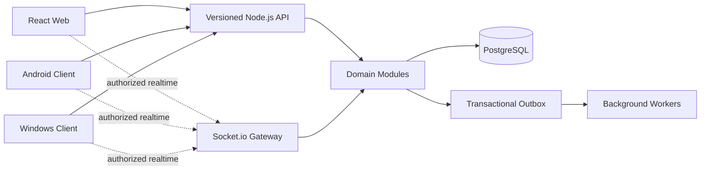

# SharVin1 Master Architecture & Task Master

**Document status:** `PROPOSED` — architecture and roadmap recommendations awaiting developer review.  
**Product:** SharVin1 B2B commerce platform for retailers and wholesalers.  
**Scale objective:** Support a growth path toward 5 million registered users; this is a capacity objective, not a verified throughput claim.  
**Stack in repository decisions:** Node.js + TypeScript + Express, PostgreSQL + Prisma, React + Vite, Socket.io.  
**Last updated:** 2026-10-27

> This document is the architecture index and prioritized task master. Detailed approved requirements and contracts remain in `PRD.md`, `TECHNICAL_ARCHITECTURE.md`, `DATABASE_DESIGN.md`, `API_SPECIFICATION.md`, `SECURITY_AND_PERFORMANCE.md`, and `DECISIONS.md`. Keep task-level implementation detail in `IMPLEMENTATION_PLAN.md`; update that registry when tasks are approved rather than maintaining two divergent task lists.

## 1. Executive Summary

SharVin1 provides a shared B2B commerce backend for retailer and wholesaler organizations, with a React web client first and Android and Windows clients following the approved platform sequence. Core workflows include organization onboarding, supplier relationships, catalog and offers, tiered pricing, order negotiation and price lock, inventory reservation and fulfillment, delivery confirmation, and credit/payment ledger operations.

The implementation should preserve a modular domain structure and a single authoritative PostgreSQL data store for transactional state. All clients use versioned APIs; the backend owns authorization, validation, pricing, state transitions, concurrency control, and financial calculations. Socket.io may deliver live updates, while durable database state remains authoritative.

The repository context reports substantial web MVP functionality and verification complete through Milestone 6, plus subsequent roadmap features. The architecture docs and implementation plan are older and report earlier states. Treat reported implementation as evidence to reconcile, not as an automatic change to approved architecture. This master plan therefore marks existing web scope `IMPLEMENTED_AND_VERIFIED` **as reported by `PROJECT_CONTEXT.md`**, and recommends inventorying current evidence before extending it.

### Engineering outcomes

- Every business record and operation is tenant-scoped and authorized server-side.
- Inventory, price locks, order transitions, credit exposure, and ledger postings are safe under retries and concurrency.
- Financial and operational history is auditable; posted ledger facts are corrected through compensating entries.
- The system can scale by measurement: identify hot paths, capacity-test realistic traffic, and add replicas, queues, partitioning, or service boundaries only when evidence warrants them.
- Product requirements and architectural choices have explicit status tags and a traceable approval history.

## 2. Core Engineering Standards

### 2.1 Decision and status conventions

Use the repository status vocabulary on every task and material design choice:

- `CONFIRMED`: explicitly approved by the developer or existing confirmed project decision.
- `PROPOSED`: recommendation awaiting review.
- `NEEDS_CLARIFICATION`: material product, security, cost, or architecture ambiguity.
- `SUPERSEDED`: replaced decision with predecessor and rationale recorded.
- `IMPLEMENTED_AND_VERIFIED`: implementation and empirical verification evidence exist.

Task lifecycle remains `BACKLOG` → `READY` → `IN_PROGRESS` → `BLOCKED` → `IN_REVIEW` → `DONE` (or `CANCELLED`). Do not mark `DONE` without acceptance evidence and required checks.

### 2.2 Architecture boundaries

- **Confirmed stack and sequencing:** Node.js/TypeScript/Express, PostgreSQL/Prisma, React/Vite, Socket.io; web first, Android second, Windows third; all clients use the shared backend. See ADR-001 and ADR-003.
- **Proposed domain modules:** identity and organizations; retailer operations/POS; wholesaler catalog; relationship and pricing; carts/orders/negotiation; inventory/fulfillment; delivery; ledger/payments; notifications and audit.
- Keep modules cohesive in the current deployable backend. Extract independently deployed services only when measured scaling, availability, or ownership needs justify added operational complexity.
- Controllers handle transport concerns; validation schemas define request shape; services enforce domain rules; repositories/data access encapsulate persistence. Never put authoritative business rules in React or Socket.io event handlers alone.
- Use API versioning and backward-compatible evolution. Treat WebSocket messages as notifications/events with documented authorization and payload schemas.

### 2.3 Data and financial correctness

- Use PostgreSQL transactions for operations that must change together. Keep transactions short and avoid network calls inside them.
- Use integer minor units for currency where supported by business rules, or PostgreSQL `NUMERIC` with explicit scale and rounding rules. Never use binary floating point for money.
- Store the applied unit price, quantity, discount, tax inputs/results, currency, and relevant rule/version snapshots on confirmed order lines.
- Treat ledger postings and stock movements as auditable facts. Use reversals/compensating rows; do not silently rewrite posted history.
- Use database constraints for uniqueness, valid ranges, and nonnegative values where they express durable invariants.
- Use UTC timestamps and explicit currency, quantity unit, and tax semantics.

### 2.4 Security, privacy, and reliability

- Resolve tenant context from authenticated membership, never from a client-supplied organization ID alone.
- Authorize each object access against both tenant ownership and role/relationship permissions. Apply least privilege to staff and service credentials.
- Validate and normalize all inputs at API boundaries; enforce business invariants again in the domain service/transaction.
- Keep secrets and sensitive credentials out of source control and logs. Hash passwords with a modern adaptive password hash; store delivery OTP verifiers securely, expire them, rate-limit attempts, and never expose raw secrets in logs.
- Use idempotency keys for retryable financial/order operations. Use an outbox for durable asynchronous event publication.
- Require audit history for sensitive administrative actions, credit overrides, verification decisions, and order/ledger adjustments.
- Establish observability, backup and restore procedures, migration discipline, incident procedures, and capacity tests before claiming production readiness.

## 3. Domain Model and System Shape

**Authority rule:** PostgreSQL transaction state is authoritative. Cache entries, socket messages, browser state, search indexes, and worker queues are derived or delivery mechanisms and must be rebuildable/reconcilable.

## 4. Complete Prioritized Task Queue — Phases 1–10

Phase status below distinguishes repository-reported implementation from proposed future scope. It does not assert independent re-verification in this document. Task IDs should be reconciled with the canonical `IMPLEMENTATION_PLAN.md` before new task IDs are assigned.

### Phase 1 — Source-of-truth reconciliation and release baseline

**Phase status:** `NEEDS_CLARIFICATION` because `PROJECT_CONTEXT.md` reports M0–M6 complete while `IMPLEMENTATION_PLAN.md` still describes early milestones as backlog.

1. **P1.1 — Reconcile project documentation and code evidence** (`READY`): compare migrations/schema, routes, tests, runbooks, and deployed assumptions with core docs; resolve each stale status and contradiction. Acceptance: one canonical task registry and accurate context handoff.
2. **P1.2 — Confirm production operating assumptions** (`NEEDS_CLARIFICATION`): deployment topology, regions, data residency, recovery objectives, expected peak traffic, and privacy/retention obligations. Record material choices in ADRs.
3. **P1.3 — Create release readiness inventory** (`PROPOSED`): environments, migrations, secrets, backups, monitoring, restore drill, and rollback steps. Acceptance: a rehearsed release and recovery procedure.

### Phase 2 — Identity, onboarding, and tenant boundaries

**Phase status:** web MVP authentication and multi-tenant hardening are reported `IMPLEMENTED_AND_VERIFIED`; reassess through P1.1 before extending.

1. **P2.1 — Organization/member lifecycle audit** (`PROPOSED`): verify owner/staff roles, membership changes, account recovery, session revocation, and business suspension.
2. **P2.2 — Business verification workflow** (`PROPOSED`): define evidence capture, review state machine, reviewer authorization, audit, and sensitive-document access.
3. **P2.3 — Relationship lifecycle** (`PROPOSED`): verify retailer–wholesaler invitations, approval, suspension, and safe closure rules when orders or balances remain open.
4. **P2.4 — Tenant isolation verification** (`PROPOSED`): test cross-tenant reads/writes on every module and privileged paths; demonstrate denial and audit outcomes.

### Phase 3 — Catalog and product identity

**Phase status:** retailer POS catalog and wholesaler catalog features are reported complete; verify current schema and APIs before altering them.

1. **P3.1 — Separate canonical product, sellable variant, and seller offer concepts** (`PROPOSED`): preserve seller-specific SKU, pack size, barcode, and availability.
2. **P3.2 — Catalog validation and lifecycle** (`PROPOSED`): duplicate handling, units of measure, active/archive state, image metadata, and import validation.
3. **P3.3 — Catalog search/read performance** (`PROPOSED`): profile real search queries; add targeted indexes and pagination/cursors based on measured workload.

### Phase 4 — Multi-tier pricing and negotiation

**Phase status:** basic wholesale pricing and bilateral rate locking are reported complete; advanced tier semantics require product approval.

1. **P4.1 — Approve pricing precedence and rule semantics** (`NEEDS_CLARIFICATION`): define contract/group/base precedence, quantity breaks, MOQ, pack conversion, tax, discount, currency, effective dates, and rounding.
2. **P4.2 — Implement deterministic price resolution** (`PROPOSED`): return applied rule identity/version and validate seller, buyer relationship, offer, and validity interval.
3. **P4.3 — Snapshot prices at agreement** (`PROPOSED`): immutable line snapshots for accepted/locked price and explainable audit history.
4. **P4.4 — Concurrency-safe mutual rate lock** (`IMPLEMENTED_AND_VERIFIED` as reported): reconcile implementation and tests; confirm simultaneous confirmations cannot lock different snapshots.

### Phase 5 — High-concurrency inventory and reservation

**Phase status:** atomic stock flows and race-edge tests are reported implemented; production-scale contention behavior remains to be capacity-verified.

1. **P5.1 — Define inventory accounting semantics** (`NEEDS_CLARIFICATION`): warehouses/locations, on-hand/reserved/available, damaged/returned stock, backorders, and reservation expiry policy.
2. **P5.2 — Atomic reservation/decrement paths** (`PROPOSED`): conditional updates or row locks with database invariants; transactionally tie reservation effects to order state.
3. **P5.3 — Idempotent reserve/release/confirm** (`PROPOSED`): ensure retries, duplicate messages, cancellation, expiry, and worker redelivery do not double-adjust quantities.
4. **P5.4 — Hot SKU concurrency tests and telemetry** (`PROPOSED`): load-test skewed contention; measure conflicts, lock waits, retries, oversell rate, and latency.
5. **P5.5 — Reconciliation and repair tooling** (`PROPOSED`): compare balances with movement/reservation history and produce auditable repair operations.

### Phase 6 — OMS, fulfillment, and delivery

**Phase status:** core order lifecycle, negotiation, dispatch, OTP handover, partial delivery, and damage handling are reported implemented; revalidate state transition coverage.

1. **P6.1 — Publish canonical order state machine** (`PROPOSED`): list states, actors, legal transitions, timeout paths, cancellation/return effects, and event schema.
2. **P6.2 — Make state transitions atomic and versioned** (`PROPOSED`): reject stale transitions, record actor/reason, and ensure related stock/ledger actions are exactly-once in effect.
3. **P6.3 — Verify partial fulfillment and adjustments** (`IMPLEMENTED_AND_VERIFIED` as reported): review acceptance, damage, invoice adjustment, inventory rebalance, and ledger reconciliation.
4. **P6.4 — Harden driver access and delivery proof** (`PROPOSED`): review token expiry/revocation, OTP attempt controls, least disclosure, and evidence retention.

### Phase 7 — Ledger, credit, and payments

**Phase status:** double-entry ledger and credit control features are reported implemented; production accounting policy and reconciliation need explicit approval/evidence.

1. **P7.1 — Approve accounting model** (`NEEDS_CLARIFICATION`): account ownership, debit/credit conventions, posting points, payment allocation, refunds, write-offs, tax/invoice treatment, and currency policy.
2. **P7.2 — Enforce balanced immutable postings** (`PROPOSED`): one transaction contains balanced entries; unique source event prevents duplicate posting; corrections reverse prior postings.
3. **P7.3 — Serialize credit exposure decisions** (`PROPOSED`): atomically reserve/consume available credit against concurrent orders and payment allocation.
4. **P7.4 — Reconciliation and statement verification** (`PROPOSED`): reproduce account balances from journal entries and compare any cached summary; alert on mismatch.
5. **P7.5 — Payment provider integration and settlement** (`BACKLOG`): only after provider, compliance, refund, reconciliation, and operational requirements are approved.

### Phase 8 — API, realtime, and background processing

**Phase status:** REST and Socket.io workflows exist per project context; durability, versioning, and failure recovery require an inventory.

1. **P8.1 — Contract review** (`PROPOSED`): align REST and socket event schemas, tenant authorization, error format, pagination, and deprecation policy with `API_SPECIFICATION.md`.
2. **P8.2 — Idempotency framework** (`PROPOSED`): define scope, request hash, retention, concurrent duplicate behavior, and stored response behavior.
3. **P8.3 — Transactional outbox and worker retries** (`PROPOSED`): atomically persist event intent, publish asynchronously, handle duplicate delivery, poison messages, and replay.
4. **P8.4 — Realtime scale strategy** (`PROPOSED`): verify adapter/fanout deployment, room authorization, reconnect resync, and socket backpressure for multiple instances.

### Phase 9 — Scale, security, and operations

**Phase status:** basic web hardening is reported complete; 5M-user readiness is not established by registered-user count alone.

1. **P9.1 — Define workload model** (`NEEDS_CLARIFICATION`): monthly/daily active users, peak requests, order bursts, hot-item distribution, data retention, payloads, geography, and latency goals.
2. **P9.2 — Load and soak testing** (`PROPOSED`): test realistic read/write mix and failure scenarios; establish throughput and saturation limits with evidence.
3. **P9.3 — Database operational readiness** (`PROPOSED`): connection pooling, slow-query review, migration locks, backup/PITR, restore drills, failover, and capacity alarms.
4. **P9.4 — Security verification** (`PROPOSED`): threat review, authorization matrix, rate-limit coverage, secret scanning, dependency hygiene, audit log access, and incident playbook.
5. **P9.5 — Scale interventions by evidence** (`PROPOSED`): use indexes, caching, read replicas, partitioning, queues, or service extraction only when measurements show a bottleneck and consistency impact is reviewed.

### Phase 10 — Client expansion and continuous improvement

**Phase status:** Android is the next platform per project context; Windows follows Android under confirmed ADR-001.

1. **P10.1 — Android scope and API parity** (`READY`): define offline/network behavior, authentication/session lifecycle, push needs, realtime reconnection, and rollout acceptance before implementation.
2. **P10.2 — Android implementation and verification** (`BACKLOG`): reuse backend contracts; verify tenant controls, order/inventory/ledger workflows, and supported-device behavior.
3. **P10.3 — Windows scope and implementation** (`BACKLOG`): begin after Android scope is sufficiently validated; preserve shared API and authorization contracts.
4. **P10.4 — Continuous capacity and domain review** (`PROPOSED`): periodically revisit hot paths, retention, recovery objectives, UX evidence, and stale decisions; update this file and canonical task plan.

## 5. Database Schema Design Notes

This is a logical blueprint, not a replacement schema migration. Existing Prisma models and `DATABASE_DESIGN.md` are the implementation sources until a reviewed migration supersedes them.

### 5.1 Main entities and relationships

| Area | Logical entities | Design notes |
|---|---|---|
| Identity | `businesses`, `users`, `business_members`, `business_verifications`, `business_addresses` | A business is the tenant boundary. Model staff membership separately from business identity and role. Avoid assuming one user equals one business. |
| Trading | `retailer_wholesaler_connections` (or approved relationship model) | Unique retailer/wholesaler pair; terms and status belong to the relationship. Enforce closure policy when obligations remain. |
| Catalog | `products`, `product_variants`, `wholesaler_offers`, `categories`, `units_of_measure` | Separate canonical identity from sellable pack/variant and seller-specific offer. Preserve current user catalog concepts pending schema reconciliation. |
| Pricing | `price_lists`, `price_tiers`, `price_rules`, `price_history` | Effective-dated, scoped rules with explicit precedence. Snapshot the applied result on agreed order lines. |
| Inventory | `inventory_locations`, `inventory_balances`, `inventory_reservations`, `inventory_movements` | Balance is a fast projection; movement history explains changes. Unique balance key per owner/location/item. Reservation lifecycle is explicit. |
| Commerce | `carts`, `orders`, `order_lines`, `order_events`, `shipments`, `shipment_lines`, `delivery_handovers` | Order lines retain product, quantity, unit, price, tax, and description snapshots. State changes and associated effects are transactional. |
| Realtime | `chat_messages`, `order_price_history`, `negotiation_states` | Persist important events and negotiation state; sockets are delivery, not storage authority. Scope every record to order and authorized parties. |
| Finance | `ledger_accounts`, `ledger_transactions`, `ledger_entries`, `payments`, `payment_allocations`, `credit_holds` | Immutable journal; balanced postings; explicit currency; unique source references; derive or reconcile balance projections. |
| Platform | `idempotency_records`, `outbox_events`, `audit_events` | Scope keys and events by tenant/operation. Define retention, redaction, retry, and access policies. |

### 5.2 Constraints and indexes

- Add foreign keys and composite tenant-aware constraints where they prevent cross-business references.
- Enforce uniqueness for relationship pairs, seller offer identity, external references, order numbers, ledger source events, and idempotency scope/key.
- Enforce `quantity > 0`, valid date ranges, allowed state values, and balanced/valid money invariants at the strongest practical layer.
- Index measured access paths: tenant + status, relationship + created time, order + event time, barcode/SKU lookup, and reservation expiry scans.
- Avoid indexing every field preemptively. Check query plans and write amplification.
- For high-volume history, establish retention/archive and partition strategies only after measuring table growth and query patterns. Preserve audit and legal retention requirements.

## 6. Strict Backend Validation and Transaction Rules

### Every request

1. Parse and validate path, query, headers, and body with a typed schema; reject unknown/invalid enum values and excessive payloads.
2. Authenticate the caller; resolve active business membership and permissions server-side.
3. Load target objects with tenant and relationship predicates in the query. Do not authorize based solely on object IDs supplied by the client.
4. Normalize units, currency, phone/identifier formats, and timestamps consistently; reject ambiguous conversions.
5. Return stable, non-sensitive error codes and correlation IDs; do not expose SQL, stack traces, OTPs, secrets, or another tenant’s data.

### Inventory and orders

- Check order status/version, offer status, relationship state, MOQ, permitted quantity, and price validity in the transaction that accepts the operation.
- Reserve/decrement using a conditional atomic database write or suitable row lock. Verify affected row count; insufficient stock must fail without partial side effects unless partial acceptance is an explicitly modeled operation.
- Use a unique idempotency record for order creation, reservation, dispatch, delivery, and cancellation actions where client/network retries can occur.
- Keep related order, reservation, and outbox changes in one database transaction. Use compensating domain actions for later reversal.
- Lock rows in deterministic order when multiple inventory or account rows are affected; keep transactions short; use bounded retry for transient serialization/deadlock errors.
- Do not use Redis/cache or stale replicas to decide final stock availability or credit eligibility.

### Pricing and negotiation

- Resolve only active offers and effective rules authorized for the buyer–seller relationship.
- Perform all money calculations using approved decimal/minor-unit semantics, deterministic rounding, and explicit tax treatment.
- Validate quantity breaks/MOQ on the server at submission and at final agreement.
- Use optimistic version checks or row locking so concurrent proposals cannot overwrite a newer proposal or produce mixed snapshots.
- When both parties confirm, persist one immutable agreed snapshot and state transition atomically. Later edits require a new proposal/version.

### Ledger and credit

- Validate account ownership, currency, permitted posting type, positive amounts, and unique source reference.
- Create a balanced set of ledger entries in one transaction; reject unbalanced postings.
- Never update/delete posted financial entries. Correct through a linked reversal/adjustment with actor, reason, and source reference.
- Serialize or atomically condition credit exposure checks and reservations against concurrent orders/payments. Define whether pending orders consume available credit.
- Generate payment allocations and receipt references idempotently. Reconcile cached account summaries against journal truth.

### Security and audit

- Apply rate limits to login, OTP verification, high-cost search, negotiation, and financial mutation paths according to approved policy.
- Use short-lived, scoped, revocable access for driver/public links; rate-limit and audit verification failures.
- Log actor, tenant, object, action, outcome, and correlation ID for sensitive changes while minimizing personal/financial data in logs.
- Validate WebSocket authentication and re-check room authorization on join and reconnect; do not treat channel membership as permanent authorization.

## 7. Rules to Prevent Duplicate Work and Technical Debt

1. **One canonical task registry:** `docs/IMPLEMENTATION_PLAN.md` owns task IDs, dependencies, status, and acceptance criteria. This master file owns architecture and phase sequencing; do not copy all implementation subtasks into another tracker.
2. **Check before creating:** search existing docs, source modules, Prisma models, migrations, routes, tests, and task IDs before adding a feature. Extend the established module when it is the correct owner.
3. **Reconcile before replacing:** inspect existing behavior and evidence. Do not rewrite working flows solely to match a new proposed model; document conflicts and get a decision when scope/security/architecture changes.
4. **No shadow business logic:** frontend calculations are previews only. Server services and database constraints own final pricing, stock, authorization, order transitions, and ledger effects.
5. **One source of truth per state:** identify whether each fact is authoritative, derived, cached, or delivered. Avoid parallel in-memory and database state for production domain facts.
6. **No silent schema drift:** every schema change has a migration, compatibility/rollback plan, updated schema docs, and data migration when needed. Never edit production data destructively without explicit approval.
7. **No duplicate endpoints or tables by naming:** search API/spec and schema before introducing alternatives; maintain backward-compatible deprecation plans.
8. **Small vertical increments:** each task includes scope, dependencies, acceptance criteria, tenant/security checks, concurrency behavior, and verification evidence. Avoid combining unrelated phases into a single change.
9. **Status integrity:** do not mark a proposal confirmed without developer approval or implemented without empirical verification. Update `PROJECT_CONTEXT.md` at session end with progress and the exact next task.
10. **Debt is explicit:** record deferred cleanup, migration risk, missing telemetry, and known limits in the relevant canonical document with an owner/task ID and resolution condition.
11. **Architecture changes need evidence:** propose service splits, sharding, event sourcing, or broad caching only with a concrete constraint, measured evidence, failure-mode analysis, and migration plan.
12. **Review docs together:** when an approved change affects requirements, architecture, schema, API, security, decisions, or roadmap, update all affected canonical docs in the same task.

## 8. Definition of Ready and Done

### Ready

- Requirement and status are clear; unresolved material decisions are recorded.
- Scope, owner module, dependencies, and affected docs/schema/API are identified.
- Acceptance criteria cover expected behavior, failure paths, tenant isolation, authorization, and concurrency where relevant.

### Done

- Implementation matches approved behavior and has no duplicate source of truth.
- Relevant tests and typecheck/build/lint checks pass according to repository workflow.
- Tenant isolation, input validation, authorization, and race behavior are verified for affected paths.
- Migrations and rollback/compatibility notes are reviewed; observability and audit needs are covered.
- Canonical docs and `PROJECT_CONTEXT.md` reflect actual verified status and the next recommended task.

## 9. Immediate Next Steps

1. Reconcile the stale milestone/task state between `PROJECT_CONTEXT.md` and `IMPLEMENTATION_PLAN.md` (`P1.1`).
2. Confirm whether this document’s ten-phase queue is accepted as the strategic roadmap; preserve approved ADRs unless explicitly superseded.
3. Scope Android as the next platform task, consistent with ADR-001 and the current project context, after the source-of-truth reconciliation.
4. Define a realistic traffic model before making any 5M-user capacity claim.

