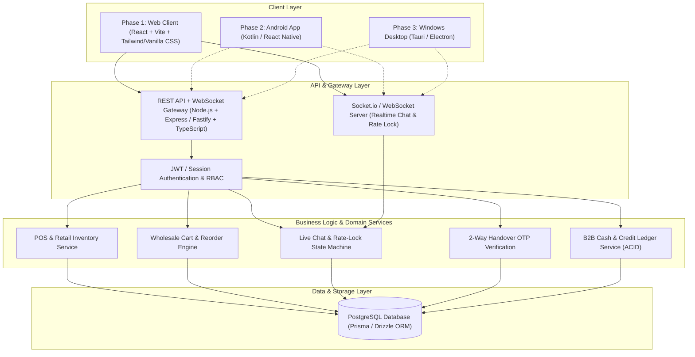

# SharVin: Technical Architecture Specification

**Status:** PROPOSED (Awaiting Developer Approval)
**Last Updated:** 2026-10-12

---

## 1. Architectural Principles `[CONFIRMED]`

1. **Shared Single Backend:** One unified API and database powers Web (Phase 1), Android (Phase 2), and Windows (Phase 3).
2. **Strict API-First Design:** All business logic, transaction safety, state machines, and calculations reside on the backend.
3. **Multi-Tenant Isolation:** Complete row-level or organizational separation between Retailers and Wholesalers.
4. **Resilience & Auditability:** Financial ledgers and inventory modifications are append-only or version-tracked with audit trails.

---

## 2. High-Level System Architecture `[PROPOSED]`

---

## 3. Technology Stack Recommendation `[PROPOSED]`

For a solo developer with ~2 hours/day seeking maximum velocity, safety, and reusability across Web, Android, and Windows:

| Layer | Recommended Technology | Rationale |
| :--- | :--- | :--- |
| **Language** | **TypeScript** (End-to-End) | Single language to learn across frontend and backend. Strong type safety eliminates subtle runtime errors. |
| **Backend API** | **Node.js + Express (or Fastify) with TypeScript** | Battle-tested, beginner-friendly, huge ecosystem, easy to write clean REST controllers and services. |
| **Realtime Engine** | **Socket.io** | First-class support for bi-directional live negotiation chat, room-based order subscriptions, and instant price-lock broadcasts. |
| **Database** | **PostgreSQL** | Relational integrity, ACID transactions (essential for financial ledgers, inventory decrement, and OTP verification). |
| **ORM / Query Layer**| **Prisma ORM** | Type-safe queries generated directly from schema, automatic migrations, and intuitive data modeling. |
| **Frontend Web** | **React + Vite + CSS Modules / Tailwind** | Ultra-fast development server, component-driven UI, responsive across desktop and mobile screens. |
| **Testing** | **Vitest / Jest + Supertest** | Fast unit and API integration testing. |

---

## 4. Multi-Tenant & RBAC Strategy `[PROPOSED]`

Every user belongs to an `Organization` (or `BusinessEntity`), which has a role:
- **`RETAILER`**: Access to POS, store inventory, linked suppliers, restocking carts, and incoming deliveries.
- **`WHOLESALER`**: Access to wholesale catalog, incoming dealer carts, negotiation chat, dispatch management, and accounts receivable ledger.
- **`ADMIN`**: Platform monitoring and support.

Every database query enforcing tenancy is scoped by `organizationId` at the service/middleware layer.

---

## 5. Shared Backend Compatibility with Future Clients `[CONFIRMED]`

- Android and Windows clients will consume the **exact same REST API endpoints and WebSocket channels** as the Web app.
- API endpoints return clean JSON payloads with standard HTTP status codes.
- No server-side HTML rendering (SSR) coupling; complete separation of frontend presentation from backend logic.
